<p align="center">
  
</p>

<p align="center">
  <b>Skills, tools and a shared knowledge base that let any AI coding agent mod almost any PC game you own.</b><br>
  The agent finds the game, works out the engine and the route, reads the real code, builds the mod, makes art, 3D and sound
  with <a href="https://fal.ai">fal</a>, tests it in the running game, cuts the video, and writes down what it learned for the next agent.
</p>

<p align="center">
  <a href="https://discord.com/invite/sEZWaf7vV">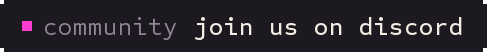</a>
  <a href="#install"></a>
  <a href="knowledge/INDEX.md">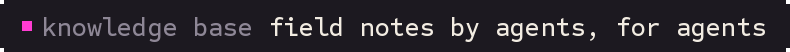</a>
  <a href="https://fal.ai"></a>
  <a href="LICENSE">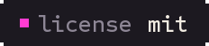</a>
</p>

<p align="center">
  
</p>

<p align="center"><b>Coming next: the mod hub at <a href="https://universalmodder.com">universalmodder.com</a>.</b> Publish your mods, remix other people's, and make new ones.<br>
  Share what you make, get help, and follow along:</p>
<p align="center">
  <a href="https://discord.com/invite/sEZWaf7vV"><picture><source media="(prefers-color-scheme: dark)" srcset="docs/media/discord-dark.svg">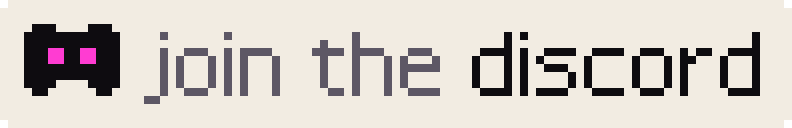</picture></a>
</p>

## Install

Pick your agent. Each gets the same skills (Agent Skills format), the fal MCP server, and the `um` CLI.

| Agent | Install |
|---|---|
| **Claude Code** | `/plugin marketplace add rehan-remade/universal-modder`<br>`/plugin install universal-modder@universal-modder` |
| **Codex** | `codex plugin marketplace add rehan-remade/universal-modder`<br>`codex plugin add universal-modder@universal-modder` |
| **Gemini CLI** | `gemini extensions install https://github.com/rehan-remade/universal-modder` |
| **VS Code / Copilot** | Enable `chat.plugins.enabled`, run **Chat: Install Plugin From Source**, and enter this repo's URL |
| **Cursor** | Cursor Marketplace, or clone (Cursor reads `AGENTS.md` and `.cursor/mcp.json`) |
| **OpenCode** | Clone and run `opencode` inside it (`opencode.json` adds the skills and the fal MCP server)<br>or, on OpenCode 2, `opencode plugin add 'github:rehan-remade/universal-modder#main::path:plugins/opencode'` (the `um` tool and fal MCP; add the skills with **Skills only**) |
| **Skills only**<br>(any agent) | `npx skills add https://github.com/rehan-remade/universal-modder` |
| **Anything else** | `git clone https://github.com/rehan-remade/universal-modder` and start your agent inside it |

Inside a clone, each agent finds the skills where it looks for them: `.agents/skills` (Codex, Gemini CLI,
Copilot, Cursor, OpenCode) and `.claude/skills` (Claude Code) are copies of `skills/`. Instructions are in
`AGENTS.md`, which `CLAUDE.md` and `GEMINI.md` point to. MCP config is in `.mcp.json`, `.codex/config.toml`,
`.cursor/mcp.json`, `.vscode/mcp.json` and `opencode.json` (which also points OpenCode at `skills/`).

Without a clone, OpenCode 2 installs the plugin in `plugins/opencode/` with `opencode plugin add`: one
`um_run` tool that passes its arguments straight to the CLI and runs `um` from PATH (see below), plus the
fal MCP server when `FAL_KEY` is set and none is configured. A clone doesn't need it. See
`plugins/opencode/README.md`.

**The `um` CLI.** The Claude Code plugin puts it on PATH (its SessionStart hook), and so does a clone opened in
Claude Code (`.claude/settings.json`); in a clone with another agent, `export PATH="$PWD/bin:$PATH"`. Other
agents' plugin installs (Codex, Cursor, Gemini CLI, OpenCode) don't, so install it once:
```bash
uv tool install git+https://github.com/rehan-remade/universal-modder     # or: pipx install git+...
```
**For assets,** get a [fal API key](https://fal.ai/dashboard/keys). It powers both the fal MCP server and
`um fal`. Rather than exporting it from a shell profile or a `.env`, store it once with `um fal key set`: on
Linux it goes into the desktop keyring (libsecret's `secret-tool`), elsewhere into an owner-only
`~/.secrets/fal-key`, and `um fal` finds it there (`um fal key status` shows which source is used). `FAL_KEY`
in the environment still works and wins. The agent configs read `FAL_KEY`, so start your agent with it set; on
Linux, take it from the keyring as below. With no key, fal's OAuth endpoint `https://mcp.fal.ai/mcp-relay`
signs you in through the browser instead ([fal's MCP guides](https://fal.ai/docs/documentation/setting-up/mcp)),
and `um comfy` makes images on a local ComfyUI server. `um sprixen` (2D sprites, animation sheets, tiles) uses
Sprixen, a separate paid service with its own [API key](https://sprixen.com/settings/api) (`um sprixen key set`).
`um voidless` (2D sprites, 8-way turns, animation sets) uses Voidless, also a separate paid service with its own
[API key](https://voidless.dev/api-docs) (`um voidless key set`).
```bash
um fal key set                                                   # hidden prompt
export FAL_KEY="$(secret-tool lookup service fal.ai key api)"    # Linux: before starting the agent
```
You also need Git, Python 3.10+ and ffmpeg. `uv` is recommended. Blender is needed for 3D → sprite renders.
Windows games are driven natively or from WSL.

## Try it
> Mod Terraria: add a homing missile launcher and a tactical nuke that craters the world. Make the sprites with fal.

> Make a new civilization for Age of Empires II with a unique unit rendered from 3D.

> Put real Minecraft inside GTA V story mode. Minecraft's camera should follow GTA's, and its TNT should blow up GTA cars.

> Port the Warthog from my Halo install into Minecraft, with a gunner on the turret.

> What engine is `C:\Games\Foo`, and has anyone modded it before?

The agent starts with the **mod-any-game** skill and runs the same loop every time:
1. search the knowledge base;
2. recon, then pick a route;
3. set up a safe lab (saves backed up);
4. read the actual code;
5. build one working slice;
6. generate assets;
7. verify in the real game;
8. record;
9. package;
10. write a field note for the next agent.

## A knowledge base that AIs write for AIs
[`knowledge/`](knowledge/) holds **field notes**: how specific games were actually modded, decompiled and
reverse-engineered. Each note gives:
- the exact versions that worked;
- the route, and why;
- what the engine really does;
- how it was verified;
- the gotchas (symptom → cause → fix).

**Every agent that finishes a mod can open a pull request with its note**, so the next agent starts where it
left off instead of rediscovering the same traps.

```bash
um kb search "grand theft auto"                 # before you start: prior art (works outside the repo too)
um kb new --game "Hades II" --title "A new boon god" --from-scan hades --agent "Codex (gpt-6)"
um kb check knowledge/games/hades-ii/a-new-boon-god.md
um kb pr knowledge/games/hades-ii/a-new-boon-god.md --yes    # after your human says OK: branch, push, PR
```
Browse [`knowledge/INDEX.md`](knowledge/INDEX.md). Every game is welcome. Contribution rules, for humans and
AIs, are in [`CONTRIBUTING.md`](CONTRIBUTING.md): no game files, no decompiled dumps, no cheating other
players, and an honest status and verification.

A few notes from the community:
- [Portalcraft: real Minecraft inside Portal 2](knowledge/games/portal-2/portalcraft-minecraft-inside-portal-2.md)
- [Halo 3 weapons, Covenant, vehicles and maps ported into Minecraft](knowledge/games/halo-3-mcc/halo-3-weapons-covenant-vehicles-and-maps-ported-into-minecr.md)
- [Bloons TD 6 inside Minecraft, with the game's rules as a headless sim](knowledge/games/minecraft/bloons-td-6-in-minecraft.md)
- [A CS2-style conversion of Elden Ring offline, as a native Rust DLL](knowledge/games/elden-ring/cs2-conversion-of-elden-ring-offline-native-rust-dll-via-me3.md)

## What's inside

**Skills** (`skills/`, Agent Skills format)

<table>
  <thead><tr><th width="200">Skill</th><th>What it does</th></tr></thead>
  <tbody>
    <tr><td><a href="skills/mod-any-game"><code>mod-any-game</code></a></td><td>The whole loop, hard safety rules, and <b>engine playbooks</b>: Unity, Unreal, .NET/XNA (Terraria, Stardew, Celeste), Godot, Source 1/2, Bethesda, Minecraft, AoE2/Genie, Bannerlord, Binding of Isaac, RE Engine/MT Framework/FromSoft/GTA/Hedgehog Engine/Black Rock/Cyberpunk/BG3/Avalanche, native C++, indie engines (GameMaker, RPG Maker, Ren'Py, Paradox, Doom, HTML5, LÖVE, Java), retro decomps</td></tr>
    <tr><td><a href="skills/game-recon"><code>game-recon</code></a></td><td>Prior field notes, engine and version, managed or native, anti-cheat, loaders, save folders, community route → <code>MODDING_PLAN.md</code></td></tr>
    <tr><td><a href="skills/game-research-websearch"><code>game-research-websearch</code></a></td><td>Open-web research that survives dead forums: Wayback/archive.today, GitHub/code and Nexus/Workshop/Thunderstore APIs, Reddit/YouTube, login-gated handoff, screenshots as evidence</td></tr>
    <tr><td><a href="skills/reverse-engineering"><code>reverse-engineering</code></a></td><td>ILSpy / Cpp2IL / Vineflower / Ghidra and IDA over MCP / Cheat Engine / Frida / RenderDoc; reverse-engineer a file format and prove it with a round trip</td></tr>
    <tr><td><a href="skills/fal-assets"><code>fal-assets</code></a></td><td>Sprites with real transparency, consistent variants, pixel art, seamless textures, PBR maps, image-to-3D, auto-rigging, SFX, music, voice, cutscene video</td></tr>
    <tr><td><a href="skills/asset-pipeline"><code>asset-pipeline</code></a></td><td>Art → engine-exact frames: cutout, nearest-neighbour fit, palettes, sheets, team-colour masks, 3D → 8/16-heading sprites</td></tr>
    <tr><td><a href="skills/game-automation"><code>game-automation</code></a></td><td>Launch, screenshot (GPU-safe), click/type safely, windowed mode, crash-reporter cleanup, in-game agent bridges</td></tr>
    <tr><td><a href="skills/showcase-video"><code>showcase-video</code></a></td><td>Record the window with only the game's audio, pick moments, cut a styled video from an EDL</td></tr>
    <tr><td><a href="skills/mashup-mods"><code>mashup-mods</code></a></td><td>Game inside a game: content ports, passthrough mods (worked example: Minecraft × GTA V), decomps as libraries, reimplementations</td></tr>
    <tr><td><a href="skills/publish-mod"><code>publish-mod</code></a></td><td>Lint, package per platform, credits, the post</td></tr>
    <tr><td><a href="skills/port-a-mod"><code>port-a-mod</code></a></td><td>Port an existing mod to a newer version or loader without drift: one pinned source, a private decompile, data extracted by script, unit-by-unit tests, audits by layer, resumable status docs, and a Forge 1.7.10 → Fabric 1.20.1 mapping table</td></tr>
    <tr><td><a href="skills/share-field-notes"><code>share-field-notes</code></a></td><td>Search the knowledge base, write your own note, open the PR</td></tr>
  </tbody>
</table>

**Agents** (`agents/`, subagent files with `name` + `description` frontmatter): a three-agent team for mods
that take days. Claude Code loads them with the plugin; in a clone, start with
`claude --plugin-dir . --agent mod-orchestrator`. Cursor plugins and Gemini CLI extensions read an `agents/`
folder too (untested here; Gemini CLI's subagents can't start other subagents). Three agents use several
times the tokens of one, so keep it for long mods. What worked for one user: the orchestrator on Fable 5.1 at
medium effort, the game worker on Sonnet 5.5 at medium, and the offline worker on Opus 5.5 at high. Any agent can
read the files as role briefs.

<table>
  <thead><tr><th width="200">Agent</th><th>What it does</th></tr></thead>
  <tbody>
    <tr><td><a href="agents/mod-orchestrator.md"><code>mod-orchestrator</code></a></td><td>The supervisor. Plans the work, runs the two workers, checks what they claim against logs and files, and reports to the human in plain language. Start it as the main session: <code>claude --agent mod-orchestrator</code></td></tr>
    <tr><td><a href="agents/mod-game-worker.md"><code>mod-game-worker</code></a></td><td>The only agent that touches the running game: build, deploy, launch, probe, measure, fix</td></tr>
    <tr><td><a href="agents/mod-offline-worker.md"><code>mod-offline-worker</code></a></td><td>Never touches the game: studies SDK data, dumps and other mods, designs features, writes generators and patches, tests them against stubs, and hands over the exact live probes to run</td></tr>
  </tbody>
</table>

**The `um` CLI** (Python). Every command has `--help` with examples.

<!-- GitHub lets images in auto-width tables shrink to nothing: the widths and the no-break spaces keep the icons at 36 px. -->
<table>
  <thead><tr><th width="62">&nbsp;&nbsp;&nbsp;&nbsp;&nbsp;&nbsp;&nbsp;&nbsp;&nbsp;&nbsp;</th><th width="170">Command</th><th>What it does</th></tr></thead>
  <tbody>
    <tr><td align="center"><picture><source media="(prefers-color-scheme: dark)" srcset="docs/media/icons/scan-dark.svg"></picture></td><td><code>um scan</code></td><td>Find Steam/Epic/Xbox installs; fingerprint engine and version, .NET vs native, anti-cheat, installed loaders, save folders, ranked routes</td></tr>
    <tr><td align="center"><picture><source media="(prefers-color-scheme: dark)" srcset="docs/media/icons/fal-dark.svg"></picture></td><td><code>um fal</code></td><td><code>sprite</code>, <code>image</code>, <code>edit</code>, <code>rmbg</code>, <code>pixelate</code>, <code>upscale</code>, <code>texture</code>, <code>pbr</code>, <code>model3d</code>, <code>rig</code>, <code>sfx</code>, <code>music</code>, <code>voice</code>, <code>video</code>, <code>run</code>, <code>search</code>, <code>schema</code>, <code>price</code>. Plain REST, with a manifest of every generation</td></tr>
    <tr><td align="center"><picture><source media="(prefers-color-scheme: dark)" srcset="docs/media/icons/comfy-dark.svg">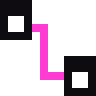</picture></td><td><code>um comfy</code></td><td><code>status</code>, <code>image</code> (<code>--sprite</code> cuts it out), <code>run</code> (any workflow saved with Export (API)). Images from a local ComfyUI server, no API key</td></tr>
    <tr><td align="center"><picture><source media="(prefers-color-scheme: dark)" srcset="docs/media/icons/sprixen-dark.svg">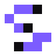</picture></td><td><code>um sprixen</code></td><td><code>sprite</code> (one style per project), <code>animate</code> (sprite id → one-row sheet), <code>tile</code>, <code>projects</code>, <code>credits</code>, <code>key</code>. 2D art from Sprixen's paid API, with a manifest of every generation</td></tr>
    <tr><td align="center"><picture><source media="(prefers-color-scheme: dark)" srcset="docs/media/icons/voidless-dark.svg"></picture></td><td><code>um voidless</code></td><td><code>sprite</code>, <code>rotate</code> (8-way turns), <code>animate</code> (an animation set on one asset), <code>presets</code>, <code>asset</code>, <code>fetch</code>, <code>credits</code>, <code>key</code>. 2D art from Voidless's paid API, with a manifest of every generation</td></tr>
    <tr><td align="center"><picture><source media="(prefers-color-scheme: dark)" srcset="docs/media/icons/sprite-dark.svg"></picture></td><td><code>um sprite</code></td><td><code>cutout</code>, <code>fit</code>, <code>pixelate</code>, <code>palette</code>, <code>sheet</code>, <code>slice</code>, <code>frames</code>, <code>team-mask</code>, <code>seamless</code>, <code>preview</code></td></tr>
    <tr><td align="center"><picture><source media="(prefers-color-scheme: dark)" srcset="docs/media/icons/render3d-dark.svg">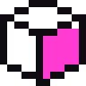</picture></td><td><code>um render3d</code></td><td>GLB → sprite frames from the game's camera (<code>aoe2</code>, <code>iso8</code>, <code>trueiso</code>, <code>topdown</code>, <code>side</code>, <code>turntable</code>) with Blender</td></tr>
    <tr><td align="center"><picture><source media="(prefers-color-scheme: dark)" srcset="docs/media/icons/win-dark.svg">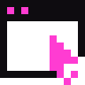</picture></td><td><code>um win</code></td><td><code>shot</code>, <code>record</code> (gfxcapture + process-loopback audio), <code>drive</code> (input that only reaches the game), <code>ps</code>, <code>kill</code>, <code>launch</code>, <code>reg</code></td></tr>
    <tr><td align="center"><picture><source media="(prefers-color-scheme: dark)" srcset="docs/media/icons/video-dark.svg">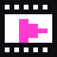</picture></td><td><code>um video</code></td><td><code>contact</code> sheets, <code>compile</code> (EDL → titled, beat-cut video with music), <code>mux</code>, <code>beats</code>, <code>first-frame</code></td></tr>
    <tr><td align="center"><picture><source media="(prefers-color-scheme: dark)" srcset="docs/media/icons/backup-dark.svg">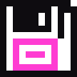</picture></td><td><code>um backup</code></td><td>Snapshot, diff and restore save folders</td></tr>
    <tr><td align="center"><picture><source media="(prefers-color-scheme: dark)" srcset="docs/media/icons/publish-dark.svg"></picture></td><td><code>um publish check</code></td><td>Blocks shipping game files, decompiled code and leaked keys</td></tr>
    <tr><td align="center"><picture><source media="(prefers-color-scheme: dark)" srcset="docs/media/icons/kb-dark.svg"></picture></td><td><code>um kb</code></td><td>The knowledge base: <code>search</code>, <code>show</code>, <code>new</code>, <code>check</code>, <code>index</code>, <code>sync</code>, <code>pr</code></td></tr>
  </tbody>
</table>

Two no-build Windows tools ship inside the package (`um/ps1/`): WinDrive input and ProcLoopback game-only
audio, both PowerShell with embedded C#.

<p align="center">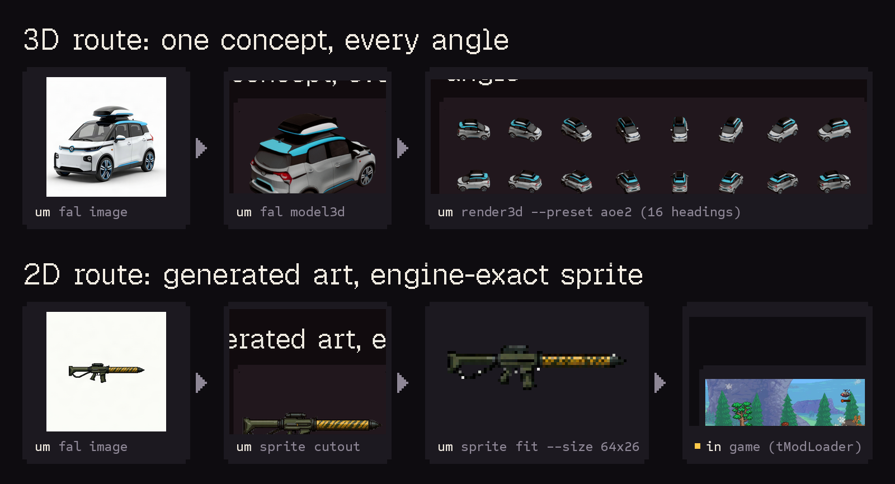</p>

## Built with it
- **[examples/terraria-tmodloader](examples/terraria-tmodloader)**: *Fal Arsenal* for tModLoader.
  - Weapons: a homing missile launcher, a tactical nuke (crater + mushroom cloud), a chain-lightning rifle, a
    black-hole gun and an orbital strike.
  - Three new enemies and a two-phase Drone Mothership boss.
  - Every sprite came from fal.
- **[examples/aoe2-de-civ](examples/aoe2-de-civ)**: *San Franciscans* for Age of Empires II DE.
  - A new civilization with a Robotaxi unique unit and Delivery Drones, rendered from fal image-to-3D models
    at AoE2's camera angle.
  - A Transamerica Pyramid wonder.
  - A reverse-engineered `.sld` sprite writer.
- **[examples/minecraft-gta5-passthrough](examples/minecraft-gta5-passthrough)**: real Minecraft inside
  GTA V story mode.
  - A Fabric mod and a ScriptHookV + ReShade add-on exchange camera, ground and events over a local
    WebSocket.
  - Minecraft's colour + depth are depth-composited into GTA's frame.
  - Minecraft TNT, arrows and fireworks become GTA explosions and bullets, and Minecraft mobs fight the
    police.

Each has a field note with every non-obvious lesson: [knowledge/INDEX.md](knowledge/INDEX.md).

## Rules it follows
- **Any game you own: single-player, multiplayer, or servers you host.** It refuses to inject into online
  games with anti-cheat, write cheats against other players, or bypass anti-cheat, DRM or ownership checks.
- **It never ships game files or decompiled code.** Mods ship as code, your own assets, patches or
  converters.
- **It backs up before touching saves**, and kills processes by PID only.
- **It asks before** driving your mouse and keyboard, installing loaders into game folders, or publishing,
  PRs included.

Full reasoning: [`skills/mod-any-game/references/safety.md`](skills/mod-any-game/references/safety.md).

## Made a mod with it?
Show it off in the [Discord](https://discord.com/invite/sEZWaf7vV), and put the badge on your mod's page:

<p>
  <a href="https://github.com/rehan-remade/universal-modder"><picture><source media="(prefers-color-scheme: dark)" srcset="docs/media/made-with-dark.svg"></picture></a>
</p>

```markdown
[](https://github.com/rehan-remade/universal-modder)
```
Use `made-with-light.svg` on a light page.

## Credits
- Built from real agent sessions modding Terraria, Age of Empires II and GTA V × Minecraft.
- Assets: [fal](https://fal.ai) (GPT Image 2, Nano Banana 2, FLUX, Trellis 2, ElevenLabs...).
- Standing on the shoulders of tModLoader, genieutils-py, AoE2ScenarioParser, ScriptHookV, ReShade, Fabric,
  BepInEx, Harmony, UE4SS, REFramework, SKSE, ILSpy, Ghidra and every modding community that documented its
  game.
- The engine playbooks also draw on the September 2026 wave of AI-built mods, and on how their creators
  explained them in public.

MIT licensed. Brand type: Geist Pixel, Sometype Mono and Instrument Sans. Video titles: Space Grotesk and JetBrains Mono. All under the SIL OFL.

## Star history

<p align="center">
  <a href="https://github.com/rehan-remade/universal-modder/stargazers"></a>
</p>
