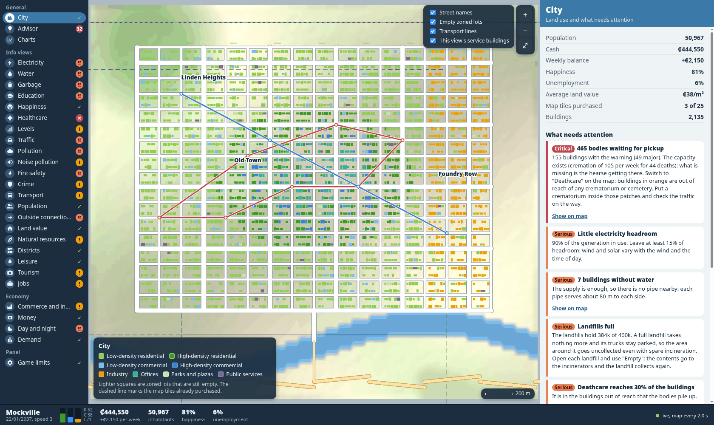
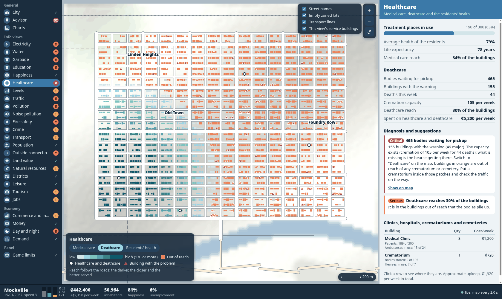
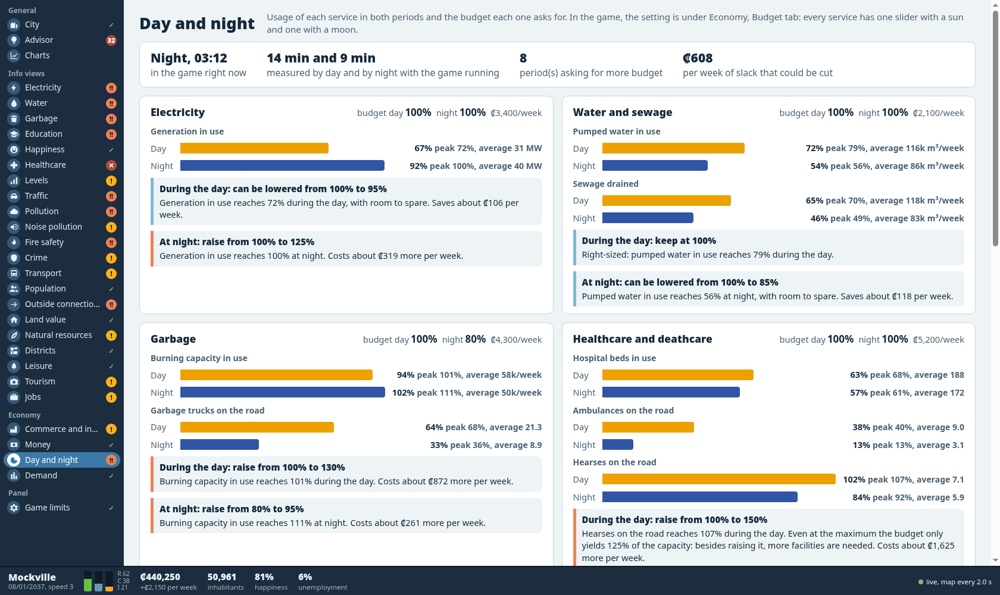

# City Dashboard for Cities: Skylines 1

A **read-only** mod that serves a live dashboard of your city at `http://127.0.0.1:19680` while the game runs:
every number the info views show (and several they don't), a detailed map you can pan and zoom, an advisor that
turns the numbers into concrete suggestions, full-screen charts, and a day/night comparison that recommends a
budget for each period. It builds nothing, changes no budget and never writes to the simulation.



It was built and run in October 2026 on Arch Linux with the **native Linux Steam build of Cities: Skylines
1.21.1-f9** (Steam build 22724702, Unity 5.6.7f1), compiled with Mono `mcs` 6.12. Not tested: Windows, macOS,
the Epic build. The field note has the engine details and every gotcha:
`knowledge/games/cities-skylines/read-only-live-city-dashboard-for-cities-skylines-1-an-http-.md`.

> **Read this before installing.** On the machine it was built on, the game aborted once, one second into a
> save, with this mod installed, and the owner lost a city that had never been saved before. Four attempts to
> reproduce it with the mod installed all saved fine, so the cause is unknown and the mod is not cleared.
> **Save your city under a new name before the first session with this mod**, and see "Known problems" below.

## Try it without the game

The page can run against a synthetic city, so you can see it (and work on it) without owning or opening the game:

```
python3 tools/mock_game.py            # then open http://127.0.0.1:19681
```

Every number in that city is made up by the script. The screenshots in this folder come from it.

## Install

Needs: Cities: Skylines 1 (Steam), the Mono C# compiler (`mcs`) and Python 3.

```
./build.sh
```

That compiles `mod/CityDashboard.cs` against the game's own assemblies (referenced, never copied), assembles
`web/src/*` into one self-contained `index.html`, and puts both in the local mods folder as `CityDashboard`.
Set `CITIES_DIR` / `MODS_DIR` if your paths differ from the Linux defaults; the script prints where it installed.

Start the game, load or create a city, and open `http://127.0.0.1:19680` in a browser. The mod enables itself the
first time the game sees it; after that it respects **Content Manager → Mods → City Dashboard**.

- `./build.sh --page` reinstalls the page only. It takes effect on a browser reload, with the game running.
- A change to the `.cs` took effect only after a game restart in testing (Gotcha 4 in the note). Restart; do not
  swap the DLL while the game is running.
- `./remove.sh` removes the mod (close the game first); `./remove.sh --all` also deletes the history.
- By default it only answers on `127.0.0.1`. To open it from another device on your network, create an empty
  `open-to-lan.txt` next to the DLL and restart the game. It then listens on every network interface with no
  password, so anyone on that network can read the city's data: only do this on a network you trust, and delete
  the file and restart to go back. Safer: keep the default and forward the port over SSH
  (`ssh -L 19680:127.0.0.1:19680 <game-pc>`).

## What is on the page

- **Left rail:** the info views (Electricity, Water, Garbage, Education … Jobs) plus Commerce and industry, Money,
  Day and night, Demand and Game limits. The mark next to each says its state: `✓`, `!`, `‼` or `✕`.
- **Map:** shaded terrain, water, forest, every building as its real rotated footprint, roads with their names,
  rails, empty zoned lots, transport lines, districts, purchased tiles. Drag to pan, scroll to zoom, hover for a
  tooltip, click to pin a building's or road's details. Each view recolours the map the way the game's info view
  does: in Healthcare → Deathcare, buildings no crematorium can reach turn orange.
- **Right panel:** numbers, diagnosis and suggestions for the view. "Show on map" marks the buildings involved.
- **Advisor:** every observation together, most serious first.
- **Charts:** full screen, one sample per in-game week, click a chart to enlarge it.
- **Day and night:** usage of each budget item in both periods (average and recent peak) and the budget each
  period needs, with the weekly cost or saving. It only measures while the simulation runs.




URL shortcuts: `#lixo`, `#saude`, `#trafego` … open a view directly (the ids are the Portuguese names, see
below); `?x=-500&z=-2600&zoom=2` opens the map at a point.

## How it works

- **A web server inside the mod.** `IUserMod.OnEnabled` starts a background thread with a `TcpListener` and a
  hand-written HTTP/1.1 responder (it only ever needs to answer GET, so `HttpListener` was never tried).
  Routes: `/`, `/api/cidade`, `/api/mapa`, `/api/servicos`, `/api/historico`, `/api/dianoite`.
- **Data is collected on demand, on the simulation thread.** A request queues an action with
  `SimulationManager.AddAction`; the action reads the managers and builds the JSON; the HTTP thread waits for it.
  Nothing runs when no page is open. Collecting on the render thread instead stalls frames (a 10,000-building map
  costs about 80 ms). If the simulation thread does not answer in 3 s the same action is handed to a
  `MonoBehaviour` pump on the main thread. Results are cached for 1 to 3 s, and each response carries the
  collection cost in an `X-Coleta-Ms` header.
- **The page paces itself.** Each loop waits for its previous request, then schedules the next at
  `max(2 s, 20 × collection cost)`, so the panel never takes more than about 5% of the game's time. A hidden tab
  asks for nothing. Unchanged responses are skipped by comparing the raw text.
- **The map is drawn from data, not screenshots.** Buildings arrive as position, angle and lot size in 8 m cells;
  road segments as start, curve midpoint and end (the page turns the midpoint into a quadratic Bézier control
  point); terrain as a height grid plus a water mask; natural resources and districts as byte grids. Everything
  is grouped into a few dozen `Path2D` objects per view, so a redraw is a handful of fills and strokes.
- **The advisor is a rule list** (`web/src/3-regras.js`): each rule is one `add(area, severity, title, text)`
  with the numbers interpolated. Budget advice inverts the game's own budget-to-capacity curve (below 100% the
  capacity falls with the square of the budget; above it the gains taper to 125% at 150%).
- **History** is one CSV line per in-game week per city, written under the game's user data folder in
  `CityDashboard/`. Loading an older save drops the lines that are now in the future.

## About the Portuguese in the code

This is the English edition of a mod written for a Brazilian player. The interface, comments and messages are
English; **identifiers, file names and the JSON wire format are Portuguese**, because the translation is generated
from the original sources by replacing text only, never logic. The words you will meet most:

| Portuguese | English | Portuguese | English |
|---|---|---|---|
| `cidade` | city | `predios` | buildings |
| `mapa` | map | `redes` | networks (roads, rails, pipes) |
| `servicos` | services | `ruas` | streets |
| `historico` | history | `zonasVazias` | empty zoned cells |
| `dianoite` | day/night | `terreno` | terrain |
| `carregado` | loaded | `caixa` | bounding box / cash |
| `dinheiro` | money | `receita` / `despesa` | income / expenses |
| `orcamento` | budget | `impostos` | taxes |
| `demanda` | demand | `populacao` | population |
| `energia` / `agua` / `esgoto` / `lixo` | electricity / water / sewage / garbage | `saude` / `funeraria` | healthcare / deathcare |
| `bombeiros` / `policia` | fire / police | `transito` / `trafego` | traffic |
| `visao` / `painel` / `trilho` | view / panel / rail | `regras` / `sugestoes` | rules / suggestions |

`web/src/1-nucleo.js` is the core (formatting, data, HTML components), `2-mapa.js` the map, `3-regras.js` the
advisor rules, `35-telas.js` the full-screen views and `4-visoes.js` the view list, panels and refresh loops.

## Known problems

- **One unexplained abort on save** (see the warning at the top). The process received SIGABRT one second after
  the save started; the temporary save file was left at 0 bytes. It happened in a session started through the
  Paradox launcher from Steam. Saving with the mod installed worked every time when the game binary was started
  directly, including with a tab polling and after swapping the DLL on disk. Until someone explains it: keep a
  save from before the mod, and if the game dies, copy `Player.log` before starting the game again (the game
  truncates it on every start).
- **Starting a second city without quitting the game breaks the session** on a modded game (81 Tiles 2 and
  TM:PE were present): the loader throws during deserialization and the simulation errors on every step. It
  happens without this mod too. Quit to desktop between cities.
- Districts and transport lines were exercised with injected data and with the synthetic city, not with a real
  city that has them.
- The upkeep shown per building is approximate.

## Credits

Built by Claude Code (Opus 5.5) for a Cities: Skylines player, who reviewed the city views one by one and asked
for what the game's own panels do not show. Cities: Skylines is by Colossal Order and Paradox Interactive; nothing
of theirs is in this folder. The Paradox modding wiki (`skylines.paradoxwikis.com/Modding_API`) documents the
`IUserMod` entry point this uses.
